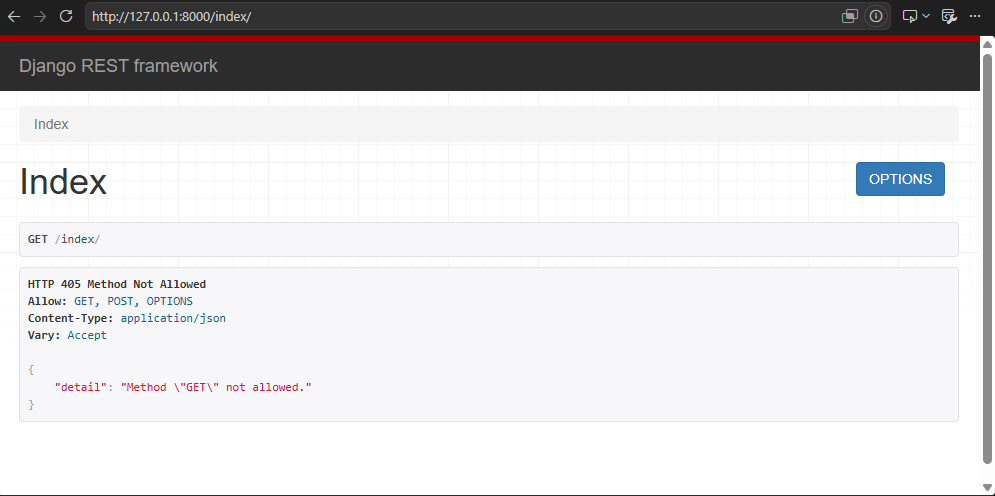

# Django Framework

> 
> 
> 
> 장고는 웹!! 프레임워크다. (프론트/백엔드 다 할 수 있음 - 이전부터 존재함)
> 
> - 우리는 거기서 **RESTful API**에만 집중하겠다.

## Web Application

‘클라이언트-서버’ 구조→ FE/BE

**일일이 만들려면 너무 어렵다.. (framework - 반복적인 코드 → 빠르게 개발할 수 있도록)

## Django

Python 기반의 웹 프레임워크 (e.g. flask, fast api)

- 주고받는 방식은 모르지만 **일단 서버를 만들어보자**

### 가상 환경

> “**가상 환경** & **의존성 패키지**” 관리하자!!
> 

가상환경:  독립적인 실행 환경

(vue는 vite가 다 해줌.. package.json, node_modules)
이제는 node_modules 직접 설치해야 함. 

1. 파이썬 가상환경 생성 - `python -m venv .venv`
    - 처음 파이썬을 설치한 것과 동일한 상태의 .venv라는 폴더가 만들어짐  
    (node_modules 같은 것 - 의존성 패키지)
2. 가상환경 활성화 - `source .venv/Scripts/Activate`
3. 패키지 목록 확인 - `pip list`
4. 의존성 패키지 목록 생성 - `pip freeze > requirements.txt`
    - package.json 같은 거 → 이걸 공유하면 됨 ㅎㅎ
- (패키지 목록 기반 설치) - `pip install -r requriements.txt`

### Django 프로젝트

- `pip install django`
- `pip freeze > requirements.txt` 의존성 패키지 목록 생성
- `django-admin startproject firstpjt .` 장고 프로젝트 생성 
(어드민아 해줘)
- `python manage.py runserver` django 프로젝트 실행 
(매니저야 해줘)

### Django Design Pattern

**디자인 패턴**:  공통적인 문제를 해결하기 위한 관행

**MVC 패턴** (Model, View, Controller)

- “데이터”, “사용자 인터페이스”, “비즈니스 로직”을 서로 분리해서 관리한다
- Django는 **MTV** (Model, Template, View - 순서대로)

### Django Project & App

Django application:  기능 단위 묘듈 (e.g. 게시글,댓글 / 회원 관리)
(⇒ 이걸 모아서 프로젝트 구성)

- `python manage.py startapp ##` app 생성
    - startproject ↔ startapp
- `“settings.py” → ‘##’ 추가` app 등록

이제 api를 만들기! (request 받고 data 반환하도록)

## REST API

**API**:  소프트웨어끼리 통신할 수 있는 메커니즘 (매뉴얼)

**REST**:  API Server 설계를 위한 “방법론” → 규칙X

- `살아 남았다는 건.. restful 하다는 것..`
- **REST에서 자원을 사용하는 법 3가지**
    1. 자원의 “식별” - URI
    2. 자원의 “행위” - HTTP Methods
    3. 자원의 “표현” - JSON 데이터

**URI에서도 Path에 집중 (어디에 무엇을 넣을 것인가?)

**Method - GET/POST/PUT/DELETE,  응답은.. status code!!

<aside>
💡

**status code (이것만 해도 반은 간다)**

- 200-299 성공(한.. 것들)
- 400-499 니가 잘못했다
- 500-599 죄송합니다 제가 잘못했습니다
</aside>

### 요청과 응답 - DRF

> 오늘은 view까지, 내일은 model~~
> 

**Django REST framework (DRF)**:  Django에서 Restful API 서버를 쉽게 구축하도록 도움

- `pip install djangorestframework`
- `pip freeze > requirements.txt`
- `+ settings.py에 기능 추가해야` (”rest_framework”)
    
    **settings.py → `app > third party lib > django core` 순으로 작성함
    

** Django와 요청 & 응답  `urls.py →  views.py → models.py`

- JsonResponse, @api_view(), Response
    
    ```python
    # urls.py
    from django.contrib import admin
    from django.urls import path
    from articles import views
    
    urlpatterns = [
        path('admin/', admin.site.urls),
        path('index/', views.index), # 어떤 path로 오면 views.py 함수를 실행시킨다.
    ]
    ```
    
    - 어떤 path로 오면 views.py의 함수를 실행시킨다.
    
    ```python
    # views.py
    
    from django.shortcuts import render
    from django.http import JsonResponse # Django 내장 HTTP 응답 클래
    from rest_framework.decorators import api_view
    from rest_framework.response import Response
    # Create your views here.
    
    # 약속. 이 함수는 무슨 일을 하는가?
    # 사용자 요청에 대한 처리를 할 것이다.
        # 마치, event 처리하듯이
        # 첫번째 인자는 항상 request
    @api_view(['GET, POST']) # method가 PUT과 같은 요청이 오면 -> 405 method not allowed
    def index(request): 
        if request.mothod == 'POST':
            return JsonResponse({'data': request.data})
        # 응답 -> JSON 형태의 데이터
        # 단순히 JSON으로 만드는게 아니라
            # 규칙을 지켜야한다. -> HTTP를 지켜서 거기에 맞는 응답 형식을 따라야 한다.
        return Response({"message": "Hello, World!"})
    ```
    
    - request에는 모든 정보 들어감 (어느 브라우저, 누가 언제 요청..)
    - HTTP 규약에 맞춰서 json형태로 응답해야 → django.http의 `JsonResponse`
        - (이것도 DRF의 .response import `Response`가 있음) 바꿔주자
    - method에 따른 조건 분기 → ㄴㄴ 각 메서드에 따라 대응하기 어려움
        - →  DRF!! (Restful하게 예쁘게 만들자 `.decorators`)
            
            
            
            경로, 상태코드, 허용 메소드, content-type은 json인데, 컨텐츠는 저렇게 왔다~~
            
        
- Variable Routing
    
    ```python
    # urls.py
    
    urlpatterns = [
        # 주소에 문자열을 받고자 한다면, 이 path함수의 위치를 신경써야 한다.
        # path('articles/<str:num>/', views.greeting),
        path('articles/<int:num>/', views.detail),
    ]
    ```
    
    ```python
    # views.py
    @api_view(['GET'])
    def article_detail(request, num):
        return Response({'num': num})
    ```
    
    - 주의사항:  문자열을 받는다면 num이 먼저 와야 (type을 바꿔줘야)
    - 인자로 넣어줘야 views.py에서 씀
    
- App URL mapping

경로만 늘어나는 게 아니라, app도 늘어남. (e.g. article, rooms, …)

- 겹칠 수 있다!! (food과 articles 둘다에 ‘food/…’ URI)
- 구분을 어떻게 할건데?
    - app에서도 url 관리하기

```python
# firstpjt/urls.py

from django.urls import path, **include**

urlpatterns = [
    # article과 관련된 요청인가요? -> 그럼 article 부서로 가세요
    # include 함수의 인자 문자열 -> '앱_네임.모듈명'
    path('articles/', include('articles.urls')),
]
```

```python
# articles/urls.py

from django.urls import path
from . import views

urlpatterns = [
    path('/', views.index),
    path('<int:num>/', views.article_detail)    
]
```

+gitignore에 .venv 넣기!!