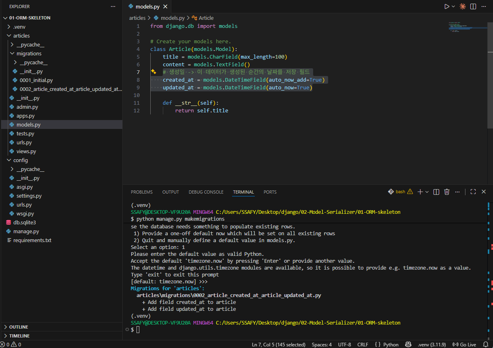

# Django_Model & ORM & Serializer

목표: JSON으로 돌려보내기

## Model

> 내 데이터베이스와 똑같은 class를 만들거다! (django models.py)
> 

```python
# models.py

from django.db import models

# Create your models here.
class Article(models.Model):
    title = models.CharField(max_length=100)
    content = models.TextField()
    
    def __str__(self):
        return self.title
```

- Model 클래스를 상속 받음
- 필드: title, content

## Migrations

: python → db로 최종 반영하는 방법

<aside>
💡

**Migrations 과정**

- model class(설계도 초안)  (1)→  migration 파일(최종 설계도)  (2)→  db.sqlite3(DB)
    - (1)=makemigrations  `python manage.py makemigrations`
    - (2)=migrate `python manage.py migrate`

**이후 좌측 ‘Database’ 메뉴에서 sqlite3 파일(’All files’) 넣고 Connect

</aside>

> 즉, 하면 되는거:  
(1) model class 변경 → (2)makemigrations → (3)migrate
> 
- (새 migration 파일은 이전 것을 의존해서 만들어진다 - 버전 관리 )
- 콘솔:  기존 데이터의 default 값 처리
    
    
    

## Admin site

admin 사이트에서도 모델 클래스 테스트 가능!

사용 방법

1. `python manage.py createsuperuser` 
2. 관리자 페이지에 app 관리하도록 추가 → admin.py
    
    ```python
    # app의 admin.py
    
    from django.contrib import admin
    from .models import Article
    # Register your models here.
    
    # 관리자.사이트.등록(Article)
    admin.site.register(Article)
    ```
    

이제 DB로부터 데이터를 받아오자!

## ORM

(Object-Relational-Mapping)
객체 지향 프로그래밍 언어를 사용하여 호환되지 않은 유형의 시스템 간에 데이터를 변환하는 기술 (번역기)

- (e.g.  Python, Java… ↔ Sqlite, MySQL, Postgres) -사용하는 언어가 다름
- 장고는 내장 ORM! → `QuerySet API`

### QuerySet API

(QuerySet:  db에게서 전달 받은 객체 목록)

- postman 사용 방법
    
    
    
    - key: value (key는 title, content)
    
- RESTful API - status code만 잘 줘도 반 이상 간다!!

구문:  `(Model class).(Manager).(Queryset API)` e.g. Article.objects.all()

- Queryset API - 메서드 모음
    
    create/update - `save()`
    
    read - `all()`, `filter()`, `get()`
    
    delete - `delete()` 
    

근데.. 

```python
def model_to_dict(article):
    '''
    Article 객체를 딕셔너리로 변환하는 함수
    :param article: Article 객체
    :return: Article 객체를 딕셔너리로 변환한 결과
    '''
    return {
        'id': article.id,
        'title': article.title,
        'content': article.content
    }
```

- 근데.. created_at도 만들려면?? (하나 더 만들어야지..;;ㅎㅎ)
- 아니 model class도 있는데? 갖다 쓸 수 없나??
- → Serializer Class!!

## Django Serializer

Serialization(직렬화)
데이터 구조/객체를 언제든, 어떤 언어든지 쓸 수 있도록 다시 만들어 놓는 것 (json)

- Serializer Class
    
    ```python
    # serializers.py
    
    from rest_framework import serializers
    from .models import Article
    
    class ArticleListSerializer(serializers.ModelSerializer):
        class Meta:
            '''
            Meta 클래스는 Serializer 클래스의 내부 클래스로, 
            serializers 가 만들어지는 설계에 대한 메타데이터를 제공
            '''
            model = Article  # Model: 직렬화할 대상 모델
            fields = ('id', 'title', 'content')
            # exclude = ('created_at', 'updated_at',)
    ```
    
    ```python
    # serializers.py
    
    class ArticleSerializer(serializers.ModelSerializer):
        class Meta:
            model = Article
            fields = '__all__'
            # # fields = ('id', 'title',)
            # exclude = ('created_at', 'updated_at',)
    ```
    
    - `__all__` 사용 가능!

- CRUD with ModelSerializer
    
    ```python
    # app의 urls.py
    
    from django.urls import path
    from . import views
    
    urlpatterns = [
        path('', views.article_list),
        path('<int:article_pk>/', views.article_detail),
    ]
    ```
    
    ```python
    # views.py
    
    @api_view(['GET', 'POST'])
    def article_list(request):
        if request.method == 'GET':
            articles = Article.objects.all()  # 모든 Article 객체를 가져옴
            # Serializer를 통해 직렬화
            # many=True: 여러 개의 데이터를 직렬화할 때 사용
            serializer = ArticleListSerializer(articles, many=True) 
            return Response(serializer.data)  # 직렬화한 데이터를 Response로 반환
        elif request.method == 'POST': # 새로운 article을 생성
            serializer = ArticleSerializer(data=request.data)  # request로 전달받은 데이터를 serializer에 담음
            if serializer.is_valid():  # serializer를 통해 입력 데이터의 유효성 검사
                serializer.save() # 유효성 검사를 통과하면 데이터베이스에 저장
                return Response(serializer.data, status=status.HTTP_201_CREATED)
            return Response(serializer.errors, status=status.HTTP_400_BAD_REQUEST)
    ```
    
    - 데이터 유효성 검사:  `is_valid()`
    - 에러 문구:  (1) `serializer.errors` ,  (2) `is_valid(raise_exception=True)`
        
        ```python
        @api_view(['GET', 'POST'])
        def article_list(request):
            if request.method == 'GET':
                articles = Article.objects.all()  # 모든 Article 객체를 가져옴
                # Serializer를 통해 직렬화
                # many=True: 여러 개의 데이터를 직렬화할 때 사용
                serializer = ArticleListSerializer(articles, many=True) 
                return Response(serializer.data)  # 직렬화한 데이터를 Response로 반환
            elif request.method == 'POST': # 새로운 article을 생성
                serializer = ArticleSerializer(data=request.data)  # request로 전달받은 데이터를 serializer에 담음
                if serializer.is_valid(raise_exception=True):  # serializer를 통해 입력 데이터의 유효성 검사
                    serializer.save() # 유효성 검사를 통과하면 데이터베이스에 저장
                    return Response(serializer.data, status=status.HTTP_201_CREATED)
                # 에러 상황이 필요한 로직이 필요하면 따로 추가
                # return Response(serializer.errors, status=status.HTTP_400_BAD_REQUEST)
        ```