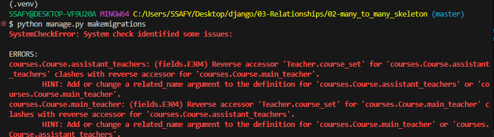

# Django_Relationship

1:N = article:comments

## Many to one relationships

`ForeignKey()` N:1 관계 설정 모델 필드 

```python
# models.py

class Comment(models.Model):
    # 하나의 게시글에 여러 댓글이 달릴 수 있으므로 ForeignKey로 Article을 참조하도록 한다.
    # ForeignKey는 다대일 관계를 나타내는 필드이다.
    # on_delete=models.CASCADE는 참조하는 객체가 삭제될 때 참조하는 객체도 삭제되도록 한다.
    article = models.ForeignKey(Article, on_delete=models.CASCADE)
    content = models.CharField(max_length=200)
    created_at = models.DateTimeField(auto_now_add=True)
    updated_at = models.DateTimeField(auto_now=True)
```

- 객체 자체를 담음

## 관계 모델 참조

### 역참조

역참조할 수 있도록 제공해줌! (1→ N를 조회하도록)

- 역참조 사용 예시:  `모델인스턴스.모델명_set.QuerySetAPI` (article.comment_set.all())
- (중간이 related manager!)

## DRF with N:1 Relation

### Post (댓글 생성)

유효성 검사를 통과해서 → comment save를 해야 한다

CommentSerializer는 어떻게 구성할까?

- 대안1
    
    ```python
    # 댓글 조회 시 게시글 정보도 함께 조회
    class CommentSerializer(serializers.ModelSerializer):
        
        class Meta:
            model = Comment
            # fields = '__all__'
            exclude = ('article',)
            # read_only_fields = ('article',)
    ```
    
- 대안2
    
    ```python
    # 댓글 조회 시 게시글 정보도 함께 조회
    class CommentSerializer(serializers.ModelSerializer):
        
        class Meta:
            model = Comment
            fields = '__all__'
            # exclude = ('article',)
            read_only_fields = ('article',)
    ```
    
- 대안3
    
    ```python
    # 댓글 조회 시 게시글 정보도 함께 조회
    class CommentSerializer(serializers.ModelSerializer):
        
        class Meta:
            model = Comment
            fields = '__all__'
            # exclude = ('article',)
            read_only_fields = ('article',)
            depth = 1
    ```
    
- 최종:
    
    ```python
    # 댓글 조회 시 게시글 정보도 함께 조회
    class CommentSerializer(serializers.ModelSerializer):
        class ArticleSerializer(serializers.ModelSerializer):
            class Meta:
                model = Article
                fields = ('id', 'title',) # 게시글의 id와 title만 보여준다.
        
        article = ArticleSerializer(read_only=True)
        class Meta:
            model = Comment
            fields = '__all__'
            # exclude = ('article',)
            # read_only_fields = ('article',)
            # depth = 1
    
    ```
    
    - article의 id와 title만 보여준다
    - article은 read_only로 둔다. (그리고 comment의 필드는 all로 두면 됨!)

## 역참조 데이터 구성

### 단일 게시글 + 댓글 목록

comment_set이 들고온 댓글 목록도 보여주면 좋겠음!

- 단, article 생성 때는 안 하도록 → `read_only=True`
    
    ```python
    # 게시글 조회 할 때 해당 게시글의 댓글도 함께 조회
    class ArticleSerializer(serializers.ModelSerializer):
        class CommentDetailSerializer(serializers.ModelSerializer):
            class Meta:
                model = Comment
                fields = ('id', 'content',)   # 댓글의 id와 content만 보여준다.
    
        # read_only=True 옵션을 통해 해당 필드를 읽기 전용으로 설정할 수 있다.
        comment_set = CommentDetailSerializer(many=True, read_only=True) # related_name을 통해 역참조
        # 댓글 갯수 표시
        # num_of_comments = serializers.SerializerMethodField()
    
        class Meta:
            model = Article
            fields = '__all__'
            # # fields = ('id', 'title',)
            # exclude = ('created_at', 'updated_at',)
    
        # def get_num_of_comments(self, obj):
        #     # 여기서 obj는 Serializer가 처리하는 Article 인스턴스
        #     # view에서 annotate 한 필드를 그대로 사용 가능
        #     return obj.num_of_comments
    ```
    

### 단일 게시글 + 댓글 갯수

(시험 안 나옴!)

`annotate` 사용! - SQL의 집계 함수를 활용하여 쿼리 단계에서 데이터 가공하는 Django ORM 함수

ㄴ Serializer도 개선해야함! 

1. SerializerMethodField()로 필드 선언
2. 메서드를 정의하면, 해당 메서드의 바환 값이 직렬화 결과에 포함되는 함수 

## Many to many relationships

ManyToManyField

```python
# models.py

from django.db import models
from teachers.models import Teacher

# Create your models here.
class Course(models.Model):
    name = models.CharField(max_length=100)
    main_teacher = models.ForeignKey(Teacher, on_delete=models.CASCADE)
    assistant_teachers = models.ManyToManyField(Teacher)
    # assistant_teachers = models.ManyToManyField(Teacher, related_name="assistant_courses")
    # assistant_teachers = models.ManyToManyField(Teacher, related_name="assistant_courses", through='CourseInfo')

```

BUT:  역참조 매니저 충돌 (N:1, N:M의 역참조 매니저 이름이 같다) → `related_name` 작성 필요



```python
from django.db import models
from teachers.models import Teacher

# Create your models here.
class Course(models.Model):
    name = models.CharField(max_length=100)
    main_teacher = models.ForeignKey(Teacher, on_delete=models.CASCADE)
    # assistant_teachers = models.ManyToManyField(Teacher)
    assistant_teachers = models.ManyToManyField(Teacher, related_name="assistant_courses")
    # assistant_teachers = models.ManyToManyField(Teacher, related_name="assistant_courses", through='CourseInfo')

```

즉, 서로에게 1:N일 뿐이다~ (서로의 관계를 저장할 중간 테이블 필요)

```python
# pk, course, 보조강사
# 1, 1, 3
# 2, 1, 5
# 3, 2, 4
# 4, 3, 3
# 4, 3, 7
# 4, 3, 6
```

단, 아쉬운게 있다 - 필드를 추가하고 싶다면? ⇒ `through 참조`

```python
# pk, course, 보조강사 + 강사번호, 언제참관, 특강 여부
# 1, 1, 3, 오늘, True, True
# 2, 1, 5, 오늘, False
# 3, 2, 4, 내일
# 4, 3, 3
# 4, 3, 7
# 4, 3, 6
```

```python
from django.db import models
from teachers.models import Teacher

# Create your models here.
class Course(models.Model):
    name = models.CharField(max_length=100)
    main_teacher = models.ForeignKey(Teacher, on_delete=models.CASCADE)
    # assistant_teachers = models.ManyToManyField(Teacher)
    # assistant_teachers = models.ManyToManyField(Teacher, related_name="assistant_courses")
    assistant_teachers = models.ManyToManyField(Teacher, related_name="assistant_courses", through='CourseInfo')

# 참조 : Through 참고 
# N:M 관계에서 추가적인 정보를 저장하고 싶은 경우에는 중개 모델을 사용할 수 있음
# 이 경우에는 중개 모델을 정의하고 through 옵션에 중개 모델을 지정하면 됨
# 중개모델에는 반드시 관계 설정을 원하는 두 모델을 ForeignKey로 지정해야 함
class CourseInfo(models.Model):
    course = models.ForeignKey(Course, on_delete=models.CASCADE)  # Course 모델과의 관계
    teacher = models.ForeignKey(Teacher, on_delete=models.CASCADE)  # Teacher 모델과의 관계
    max_student = models.PositiveIntegerField(default=20)
    is_nessary = models.BooleanField(default=False)
    
    class Meta:
        unique_together = ('course', 'teacher')
```

참조 테이블에 쓸 수 있는 메서드 - `add()`, `remove()`

단, 관계는 대칭적이지 않을 수 있다!

⇒ ManyToManyField 대표 인자 3가지 - `related_name`, `symmetrical`, `through`

### 참고

`get_object_or_404()` , `get_list_or_404()`

기존 DoesNotExist 예외 대신 Http404를 raise함!